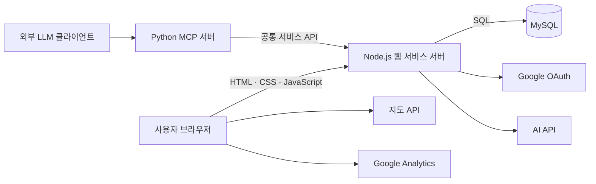

# 가용시간 기반 대학생 스터디 모집 서비스

대학생이 자신의 일정과 참여 가능한 시간을 기준으로 오프라인 스터디를 찾고, 서비스 안에서 참여 신청부터 그룹장의 승인까지 처리할 수 있는 웹 플랫폼입니다.

RPG 게임에서 파티장이 조건에 맞는 파티원을 모집하는 방식에서 착안했습니다. 그룹장은 학습 목표, 일정, 장소, 정원, 참여 조건을 설정하고, 참여 희망자는 조건에 맞는 스터디를 검색해 참여를 신청합니다.

> 현재 개발 중인 프로젝트이며 기능과 실행 방법은 구현 진행에 따라 갱신됩니다.

## 프로젝트 목표

기존 스터디 모집 과정에서는 모집 글 확인, 일정 비교, 외부 연락, 참여자 관리가 여러 서비스에 나뉘어 있습니다. 이 프로젝트는 다음 과정을 하나의 웹 서비스로 연결합니다.

1. 개인 가용시간 등록
2. 과목·날짜·시간에 맞는 스터디 검색
3. 스터디 상세 정보와 오프라인 장소 확인
4. 그룹장에게 참여 신청
5. 그룹장의 승인 또는 거절
6. 승인 인원 기준 정원 관리와 자동 모집 마감

## 주요 기능

### 회원 및 개인화

- 이메일·비밀번호 회원가입 및 로그인
- Google 소셜 로그인
- 닉네임, 관심 과목, 자기소개 관리
- 요일별 가용시간과 개인 일정 관리
- 개설·참여·신청 내역 조회

### 스터디 개설 및 탐색

- 스터디명, 과목, 학습 목표, 날짜, 시간, 정원, 참여 조건 설정
- 오프라인 모임 장소 지정
- 스터디명·과목·날짜·가용시간 기반 검색
- 모집 목록 및 상세 정보 조회

시간 검색은 스터디 일정 전체가 사용자의 참여 가능 시간 안에 포함될 때만 통과합니다.

```text
사용자 가능 시간: 13:00 ───────────────── 18:00
스터디 시간:          14:00 ─────── 16:00   ✓ 포함
스터디 시간:     12:00 ─────── 15:00        ✗ 제외
```

### 참여 신청 및 그룹장 관리

- 선택적인 신청 메시지와 함께 참여 신청
- 신청 상태 확인 및 대기 신청 취소
- 그룹장의 신청자 프로필 확인과 승인·거절
- 중복 신청 및 중복 참여 방지
- 승인된 사용자만 구성원으로 등록
- 정원 충족 시 모집 자동 마감

### 지도 기반 장소 선택

- 장소명 또는 주소 검색
- 지도에서 모임 장소 선택
- 장소명, 주소, 위도, 경도 저장
- 상세 화면에 장소와 지도 마커 표시

### AI 학습 지원

- 시간표 이미지에서 과목·요일·시간 추출
- 추출 결과 확인·수정 후 개인 일정 저장
- 수업과 개인 일정을 제외한 가용시간 계산
- 학습 녹음 파일의 텍스트 변환 및 요약
- 처리 중·완료·실패 상태와 재시도 흐름 제공

### 통계 및 이용 분석

- 과목별·요일별 모집 중인 스터디 수 시각화
- 페이지 조회, 검색, 개설, 신청 성공 이벤트 분석
- 개인정보를 포함하지 않는 분석 이벤트 설계

### MCP 연동

Python MCP 서버를 통해 외부 LLM 클라이언트에서도 스터디 검색, 상세 조회, 참여 신청 기능을 사용할 수 있도록 구성합니다. MCP 서버는 MySQL을 직접 수정하지 않고 Node.js 공통 서비스 API를 호출합니다.

## 핵심 처리 규칙

- 스터디는 오프라인 모임을 기준으로 합니다.
- 모집 정원에는 그룹장이 포함됩니다.
- 대기 중인 신청자는 현재 인원에 포함하지 않습니다.
- 그룹장이 승인한 사용자만 구성원이 됩니다.
- 정원 충족 시 모집을 자동 마감하고 신규 검색 결과에서 제외합니다.
- 마감된 스터디도 참여자의 활동 내역에는 유지합니다.
- 중복 신청, 중복 승인, 권한 없는 승인 요청을 서버에서 검증합니다.
- 동시 승인 상황에서도 정원을 초과하지 않도록 트랜잭션과 행 잠금을 사용합니다.

## 기술 스택

| 영역 | 기술 |
| --- | --- |
| Frontend | HTML5, CSS3, JavaScript |
| Backend | Node.js 내장 `http` 모듈 |
| Database | MySQL |
| MCP Server | Python |
| Infrastructure | AWS EC2, Ubuntu |
| Authentication | Email/Password, Google OAuth |
| External Services | 지도 API, AI API, Google Analytics |
| Version Control | Git, GitHub |

백엔드는 Express 없이 Node.js 내장 모듈을 사용해 구현합니다.

## 시스템 구성



초기 배포에서는 웹 서비스 서버, MySQL, MCP 서버를 하나의 AWS EC2 인스턴스에서 운영합니다.

## 프로젝트 구조

```text
AWS_P/
├─ frontend/
│  ├─ find-group.html
│  ├─ css/
│  │  └─ styles.css
│  ├─ js/
│  │  └─ app.js
│  └─ README.md
└─ README.md
```

## 실행

```powershell
cd Tool
npm.cmd install
npm.cmd start
```

브라우저에서 `http://localhost:3000`을 열면 로그인 화면이 표시됩니다. 스터디 탐색은 `/find-group.html`, 녹음 변환·요약은 `/ai-tools/`, 시간표 이미지 분석은 `/ai-tools/timetable.html`에서 제공합니다.

시간표 화면에서 `확인 및 저장`을 누르면 계산된 가용시간이 같은 브라우저의 localStorage에 저장됩니다. 메인 탐색 화면의 `저장된 가용시간 적용` 필터는 이 데이터를 읽어 일정 전체가 가용시간 안에 포함되는 스터디만 표시합니다.

## 개발 현황

- [o] 프로젝트 요구사항 및 화면 흐름 설계
- [o] 스터디 탐색 화면 초안
- [o] 회원가입·로그인·마이페이지
- [ ] 스터디 상세·개설 화면
- [ ] 참여 신청·그룹장 관리 화면
- [ ] Node.js API 및 MySQL 연결
- [o] 지도 기반 장소 선택
- [o] AI 시간표 분석 및 녹음 요약
- [ ] 모집 통계 및 Google Analytics
- [ ] Python MCP 서버 연동
- [ ] 통합 테스트, 보안 점검, AWS EC2 배포

## 개발 일정

| 단계 | 기간 | 주요 작업 |
| --- | --- | --- |
| 기획·설계 | 1~4주차 | 요구사항, 화면, 시스템 구성, 역할 분담 |
| 핵심 기능 개발 | 5~9주차 | 회원, 스터디 개설·탐색, 신청·승인 |
| 외부 기능 연동 | 9~12주차 | 지도, AI, 통계, MCP |
| 품질 개선 | 12~14주차 | 성능, 보안, 통합 테스트 |
| 최종 배포 | 15주차 | AWS EC2 배포, 보고서, 발표 |

## 보안 및 테스트

- 비밀번호 안전한 해시 저장 및 서버 측 권한 검증
- 매개변수화된 SQL과 환경변수 기반 비밀정보 관리
- 업로드 파일 형식·크기 검증과 개인 파일 접근 제어
- 검색 시간 경계값과 신청 상태 전환 테스트
- 동시 승인 시 정원 초과 방지 테스트
- 외부 지도·AI 서비스 실패 처리 테스트
- MCP 도구와 웹 API 결과 일치 확인

## Repository

[github.com/dudektls/AWS_P](https://github.com/dudektls/AWS_P)
